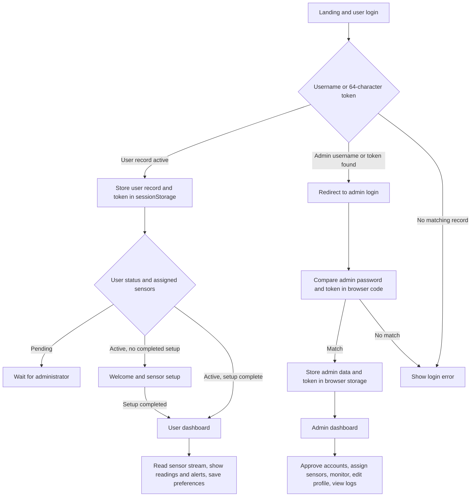

# BreathSafe application workflow review

Review date: 2026-10-21

This document records the workflow implemented in the checked-out HTML and JavaScript source and the workflow needed for a safe operational version. It assumes a database is reachable when describing the current UI behavior. It does not imply that the current application can authenticate securely or that its Firebase rules permit access: the checked-in rules intentionally deny all client access.

## Current application workflow in source

### Registration and activation

1. The signup page validates username, name, Gmail address, and Jordanian phone number in the browser.
2. It queries the `users` and `admins` Firestore collections for duplicates, generates a 256-bit API token, and creates `users/{username}` with `status: pending`, an empty `assignedSensorTypes` array, and `welcomeCompleted: false`.
3. The success modal shows the API token to the user. This token is then used as a bearer-style login credential; the current implementation does not create a Firebase Authentication account.
4. An administrator approves a pending user, selects sensor types, and writes `status: active` plus `assignedSensorTypes` to that user document.
5. The user signs in again. The welcome page reads that profile, waits if no sensors are assigned, and saves location/setup completion fields before routing to the dashboard.

### Login and admin work

- User login searches Firestore by username or API token, rejects non-active users, and stores the returned user profile and API token in `sessionStorage`.
- Admin login finds an `admins` record by username, compares the submitted password and API token against fields returned to browser code, and stores the admin record, role, permissions, and token in browser storage.
- Admin pages check for a `breathsafeAdmin` session object. Those checks are UI routing only; browser storage and JavaScript can be edited by the visitor.
- The admin dashboard reads user records and activity data, changes account status, assigns sensor types, edits admin profile data, and reads online-presence/session data from Realtime Database.

### User dashboard and alerts

- The dashboard reads `users/{userId}`, a per-user `user_settings/{userId}` document, and the Realtime Database path `Sensors`.
- The dashboard, profile page, and settings page each contain sensor monitoring and danger-alert logic. They calculate warning/danger states in the browser, can display notifications, and may send EmailJS alerts and write alert logs.
- Presence and session termination are written/read at `presence/{userId}` and `userSessions/{userId}`. Settings and profile changes are written to Firestore.

## Concrete workflow and logic problems found

These are source-level findings. A live browser test against the original backend is not possible with the placeholder configuration and deny-all rules.

1. **The current database setup cannot run the workflow.** Firestore and Realtime Database rules in this repository deny all client reads and writes. With the current rules, registration, login, admin actions, sensor reads, settings, presence, and logs fail with permission errors. This is intentional until a trusted authorization design is implemented.
2. **There is no server-verified user or admin identity.** User credentials, admin password checks, role checks, and permissions are implemented in browser code. A database being reachable does not make these checks trustworthy.
3. **Admin access is based on editable browser state.** The admin dashboard and related pages use `sessionStorage` as their access gate. A visitor can edit or fabricate the session object; the UI gate is not authorization.
4. **Sensor ownership is not represented in the live read path.** User pages read the shared root path `Sensors`; the profile only tracks assigned sensor *types*, not sensor/device IDs. As written, there is no per-user path selection or reliable mapping from a user to a physical sensor. If multiple devices/users exist, readings can be misattributed or shared.
5. **Danger monitoring is duplicated across pages.** Dashboard, profile, and settings pages independently subscribe to sensor data and implement alerts. Opening more than one page can cause duplicate notifications/emails/log writes; local-storage cooldown checks are not atomic and do not provide a single alert authority.
6. **Alert correctness is not established.** Thresholds, unit conversions, sensor calibration, stale/missing readings, connectivity-loss behavior, retry behavior, and delivery guarantees need hardware-level validation. Browser logic is not a certified gas alarm and cannot be treated as a life-safety control.
7. **Recovery was designed to expose a reusable login token.** That code and its form/SDK connections have now been removed from the source showcase; the page states that recovery is disabled. A functional version must use a trusted one-time password-reset flow, not disclose an existing credential.
8. **Signup can overwrite an existing account.** Availability checks run before the write, then signup calls `.doc(username).set(...)` without a transaction or create-only condition. Two concurrent signups can both pass the check, and the later write can replace the existing profile/token at the same document ID. The backend must enforce uniqueness and create the profile atomically.
9. **Several application modules still build HTML from records.** Prior review counted 240 DOM/HTML insertion sites. Some have been fixed, but the remaining sinks need contextual review; escaping one template does not make other insertions safe.
10. **The app and showcase configuration intentionally disagree with a working app.** Firebase and EmailJS identifiers are placeholders; Firebase rules are deny-all. A local server such as Live Server serves files but does not restore these services.

## Recommended functional workflow when rebuilding with a working backend

1. **Create account:** validate fields for usability in the browser, then create identity with Firebase Authentication. A trusted backend creates a profile with `status: pending`. Never store a password, raw bearer token, or authorization decision in a client-readable profile document.
2. **Approve and assign:** backend verifies an admin custom claim before changing account status or assigning an explicit device ID. The database rules allow the user to read only their own allowed profile/settings and the backend/admin to perform approved changes.
3. **Sign in:** Firebase Authentication establishes the session. Every protected page checks the current authenticated identity; the backend and database rules enforce ownership and admin claims independently of UI checks.
4. **Complete setup:** the user saves only their permitted profile/location/preferences. Backend validates fields and records setup completion.
5. **Ingest sensor data:** the device authenticates through a device-specific trusted ingestion path. Store readings by device ID with server timestamp, sequence/quality metadata, and validated numeric ranges. Do not let arbitrary browser clients write sensor values.
6. **Monitor:** the UI subscribes only to the authenticated user's assigned device(s). A trusted alert service evaluates thresholds once, records a durable alert event, and sends notifications with deduplication/idempotency. UI alert banners remain helpful secondary displays.
7. **Admin operations:** the backend checks verified admin claims and permissions for user approval, sensor assignment, account disablement, session revocation, exports, and audit logs.
8. **Recovery and logout:** use Firebase Auth password reset or an equivalent one-time recovery flow; logout revokes the local auth session and unregisters listeners/presence safely.

## GitHub and further verification status

- The working tree currently has no tracked files (`git ls-files` returned no entries); the project files are untracked in this checkout. Review the intended source set before the first `git add`.
- `.env`, service-account JSON paths, Firebase debug logs, build output, dependencies, and the separate `js-code-tree-extension/` directory are covered by `.gitignore`. The service-account JSON was removed locally after the supplied report recorded IAM key revocation; `.env` and Firebase debug logs remain local. Check staged contents and ignored-file status before pushing. Never force-add them.
- Browser SDK identifiers are placeholders. Their presence in frontend code would not make them secret; real credentials/service-account keys must never be committed.
- The current Jest run in this environment is blocked before tests start by sandbox `EPERM` resolving the Windows Temp path. The previous review passed the validator suite once using a local filesystem compatibility shim; that does not test end-to-end workflows.
- Before an operational release, add and run Firebase Emulator tests for Firestore/Realtime Database rules, authentication/role and ownership denial cases, registration/approval/setup flows, sensor-to-user mapping, alert deduplication, failure/reconnect behavior, and browser tests for each route. Repeat dependency and secret scans in CI and have the rules/auth design independently reviewed.

## Release decision

This is suitable as a sanitized source showcase only after reviewing the actual staged file list. It is not ready to connect to real users, credentials, devices, or sensor data. A functioning backend alone is insufficient; the client authentication model, rules, sensor ownership, alert authority, and recovery flow must also be redesigned and tested.
