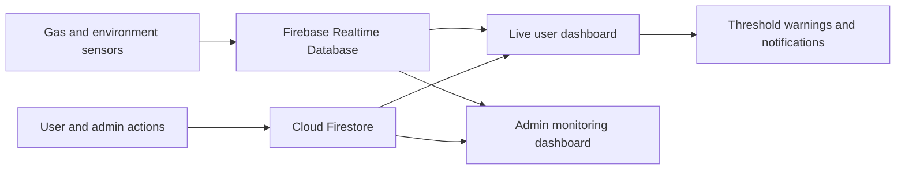

# BreathSafe — Original Project Overview for CV

## Project at a glance

**BreathSafe** is a web-based gas-leak monitoring platform built to help users view sensor readings and receive timely warnings through a simple dashboard. The application combines a user portal, an administrator portal, Firebase data services, live sensor updates, charts, and configurable alert notifications.

The interface supports three sensor categories:

- **MQ-6:** LPG and propane gas readings.
- **MQ-7:** carbon monoxide readings.
- **DHT22:** temperature and humidity readings.

The system receives sensor values through Firebase Realtime Database, while Firestore stores user profiles, account status, and application settings. The web interface listens for new values and updates the relevant cards, charts, and alert states without requiring the user to refresh the page.

## CV-ready project entry

**BreathSafe | Smart Gas-Leak Monitoring Platform**  
*Graduation Project*

- Built a multi-page web platform for monitoring LPG, carbon monoxide, temperature, and humidity readings through a live dashboard.
- Integrated the browser application with Firebase Realtime Database for streaming sensor values and Firestore for user profiles, account workflows, and settings.
- Developed user registration, onboarding, profile, and settings flows, alongside an administrator portal for account approval and sensor assignment.
- Implemented live sensor cards, trend charts, configurable thresholds, warning states, browser notifications, audible alarms, and email alert workflows.
- Created an administrator dashboard for user management, sensor monitoring, online activity, notifications, and system logs.
- Structured the application with reusable JavaScript modules for dashboard features, validation, input handling, notifications, and account management.

**Technologies:** JavaScript, HTML, CSS, Firebase Firestore, Firebase Realtime Database, Chart.js, EmailJS, Vite.

## How the platform works

### User workflow

1. **Create an account:** the user submits their details through the registration page.
2. **Administrator review:** the account appears in the admin portal as pending. The administrator reviews the request, activates the account, and assigns the sensor categories relevant to that user.
3. **Complete setup:** after activation, the user enters the welcome flow, reviews the assigned sensors, and completes initial profile and location setup.
4. **Monitor readings:** the user dashboard displays current sensor values, status indicators, historical trends, and notifications.
5. **Manage preferences:** profile and settings pages allow users to update account details, choose display units and theme, and configure alert preferences.

### Administrator workflow

The administrator signs in to a dedicated portal and uses the dashboard to:

- Review pending account requests and activate or deactivate accounts.
- Assign supported sensor categories to each user.
- View sensor readings and chart trends.
- Monitor account activity and online status.
- Review notifications and system activity logs.
- Manage administrator profile and interface preferences.

### Sensor monitoring and alert workflow

The application listens to the sensor data in Firebase Realtime Database. When new readings arrive, the dashboard updates the sensor cards and charts, compares values with configured warning and danger thresholds, and displays the corresponding status.

When a reading reaches a danger threshold, the user interface can raise a prominent visual warning, play an alarm sound, show a browser notification, and send an email through the configured EmailJS workflow. Alert history and preferences are also reflected in the user pages. This lets the user see both the current sensor state and recent warning activity in one place.

## Main application areas

| Area | What it provides |
| --- | --- |
| Login and registration | User access, account creation, and status-aware routing. |
| Welcome and setup | First-time setup and sensor assignment overview. |
| User dashboard | Live readings, sensor status cards, charts, notification history, and account status. |
| User profile | Profile information, assigned sensor summary, and account management. |
| User settings | Theme, measurement units, and alert preferences. |
| Admin dashboard | Account approval, sensor assignment, monitoring summaries, and administrative actions. |
| Admin monitoring and logs | User activity, online/session state, notifications, and system activity records. |

## High-level data flow

Realtime Database carries the changing sensor readings. Firestore supports account records, approval status, profile data, and user preferences. JavaScript modules coordinate page behavior, data listeners, chart updates, form interactions, and alert presentation.

## Short interview explanation

> “BreathSafe is my graduation project: a web platform for monitoring gas and environmental sensor readings. Users register and, after administrator approval and sensor assignment, can follow live readings and charts from their dashboard. The app evaluates incoming values against configured thresholds and presents warnings through the interface, sound, browser notifications, and email. Administrators have a separate dashboard to approve users, assign sensor categories, and monitor activity. I built the front-end workflows with JavaScript and connected them to Firebase Realtime Database and Firestore.”

## Current repository note

This document describes the **original functional project** for CV and presentation purposes. The repository was later prepared as a sanitized public source showcase, so its current Firebase settings and database rules differ from the original working configuration. The current showcase is not connected to the original live services.
