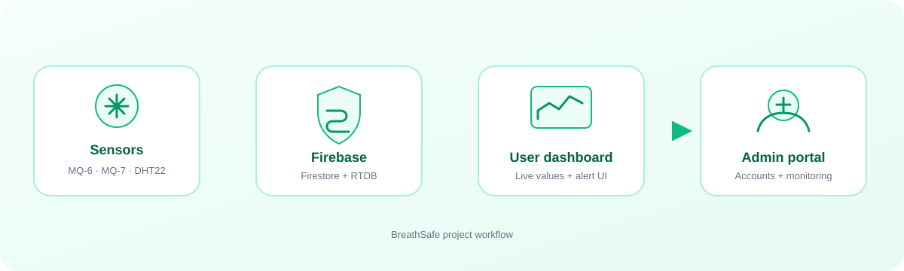

<p align="center">
  
</p>

<h1 align="center">BreathSafe</h1>

<p align="center"><strong>A student project exploring gas-sensor monitoring, live dashboards, and user alerts.</strong></p>

<p align="center">
  
</p>

<p align="center">
  
  
  
</p>

> **Safety and security notice**
>
> BreathSafe is a learning prototype and source-code showcase. It is **not** a certified gas detector, fire alarm, or life-safety system. The checked-in Firebase configuration uses placeholders, and the checked-in Firestore and Realtime Database rules deny all client access. As published, the application cannot complete its Firebase-backed workflows. Do not use it to protect people or property, or connect it to real accounts, devices, or sensor data.

## What BreathSafe explores

BreathSafe is a browser-based gas-monitoring concept. Its pages explore how a monitoring product might bring together:

- A user area for sensor readings, charts, profile details, and alert preferences.
- An administrator area for reviewing accounts, assigning sensor categories, monitoring activity, and viewing system logs.
- A Firebase client data layer using Cloud Firestore and Realtime Database.
- Browser-side warning interfaces, including visual banners, sound, browser notifications, and an EmailJS integration in parts of the prototype.

The intended physical setup is a microcontroller such as an ESP32 connected to gas and environmental sensors (the source references MQ-series sensors and temperature/humidity readings). This repository does not include a verified device-ingestion service or a validated hardware calibration procedure. Treat that setup as a project concept, not a tested product specification.

## Visual overview

The graphic below summarizes the intended relationship between a sensor source, Firebase data, the user dashboard, and administrator tools. It describes the prototype’s concept; it does not imply that a secure or production-ready backend is configured.

<p align="center">
  
</p>

## How the application is organized

### User journey

1. **Sign up:** a visitor enters account details. The browser validates the form and the prototype prepares a pending user record.
2. **Wait for approval:** the account is intended to remain pending until an administrator reviews it.
3. **Welcome and setup:** after activation, the user is guided through an onboarding page and basic preferences.
4. **Monitor:** the dashboard presents sensor values, trends, status cards, and a notification history.
5. **Manage the account:** profile and settings pages provide profile editing, appearance choices, units, and alert preferences.

The current source uses browser-side credentials and session data for parts of sign-in and page routing. Those checks are not a trusted identity or authorization system. See [Security status](#security-status-and-current-limitations).

### Administrator journey

The administrator interface is designed to support these tasks:

- Review pending users and activate or disable accounts.
- Assign sensor **types** to a user in the current UI.
- View dashboard summaries, sensor charts, user activity, and system logs.
- Manage administrator profile details and inspect security-related UI events.

These are prototype UI workflows. The checked-in database rules currently reject every client read and write, and the browser-side administrator gate can be altered by a visitor. A working database connection alone would not make these actions secure.

### Reading and alert concept

The user-facing pages subscribe to the shared Realtime Database path named `Sensors` and compare returned values with thresholds configured in browser code. Depending on the page and browser permissions, the prototype can display a danger banner, play an alarm sound, show a browser notification, persist alert state locally, and attempt to send an email through EmailJS. The dashboard also maintains charts, status indicators, and a local notification list.

Alert evaluation is currently duplicated across the dashboard, profile, and settings pages. It runs in the browser, and multiple open pages can process the same reading. There is no trusted, single alert service that validates readings, deduplicates incidents, or guarantees delivery. Thresholds, calibration, stale readings, sensor faults, connectivity loss, and notification delivery have not been validated for safety use. “No recent data” must never be interpreted as “safe.”

## Technology

| Area | Technology in the source | Purpose |
| --- | --- | --- |
| Interface | HTML, CSS, JavaScript | Login, onboarding, user dashboard, admin pages, profile, and settings |
| Data services | Firebase Web SDKs | Firestore documents and Realtime Database listeners used by prototype pages |
| Charts | Chart.js | Sensor and dashboard visualizations |
| Notifications | Browser Notification API, audio, EmailJS client library | Prototype notification channels; these are not guaranteed alert delivery |
| Local development | Vite | Multi-page local development and production build output |
| Tests | Jest, Firebase Rules Unit Testing | Validator/security utility tests and deny-all rules tests |
| Local backend checks | Firebase Emulator Suite | Runs local Firestore and Realtime Database rules tests under a `demo-*` project ID |

Most legacy pages load Firebase SDKs directly from Google’s CDN, while newer user pages use ES module imports. The repository therefore contains a mix of classic scripts and ES modules.

## JavaScript file guide

The following guide covers the JavaScript files intended for the repository showcase. Separate legacy files and the VS Code extension are excluded by `.gitignore`.

### Sign-in, registration, and account state

| File | Responsibility |
| --- | --- |
| [`Login-codes/breathsafe-login.js`](Login-codes/breathsafe-login.js) | User sign-in form behavior, account lookup, status handling, and login-attempt lockout integration. |
| [`Login-codes/breathsafe-login-security.js`](Login-codes/breathsafe-login-security.js) | Adds the login page’s device/block checks and account security UI behavior. |
| [`Login-codes/breathsafe-admin-login.js`](Login-codes/breathsafe-admin-login.js) | Administrator sign-in form and the prototype’s browser-side admin credential flow. |
| [`Login-codes/signup.js`](Login-codes/signup.js) | Registration form validation, duplicate checks, and creation of a pending user record. |
| [`Login-codes/device-fingerprint.js`](Login-codes/device-fingerprint.js) | Creates and caches a browser/device identifier used by the prototype’s blocking and login-security flows. It is not a reliable identity proof. |
| [`Login-codes/blocked-screen.js`](Login-codes/blocked-screen.js) | Detects blocked-account conditions and routes the visitor to the blocked page. |
| [`Login-codes/blocked-screen-page.js`](Login-codes/blocked-screen-page.js) | Displays the blocked-account page and checks for account-status changes. |

### Administrator dashboard

| File | Responsibility |
| --- | --- |
| [`admin-dashboard-js/admin-dashboard-core.js`](admin-dashboard-js/admin-dashboard-core.js) | Main dashboard orchestration, summary data, account actions, and core UI behavior. |
| [`admin-dashboard-js/admin-dashboard-navigation.js`](admin-dashboard-js/admin-dashboard-navigation.js) | Switches between admin dashboard sections and manages navigation state. |
| [`admin-dashboard-js/admin-dashboard-sensors.js`](admin-dashboard-js/admin-dashboard-sensors.js) | Reads sensor data for the admin view and updates sensor cards, trends, and charts. |
| [`admin-dashboard-js/admin-dashboard-analytics.js`](admin-dashboard-js/admin-dashboard-analytics.js) | Builds analytics views and supporting performance-oriented rendering helpers. |
| [`admin-dashboard-js/admin-dashboard-activity.js`](admin-dashboard-js/admin-dashboard-activity.js) | Tracks selected admin UI activity and interaction events. |
| [`admin-dashboard-js/admin-dashboard-table-controls-fixed.js`](admin-dashboard-js/admin-dashboard-table-controls-fixed.js) | Search, filter, sort, and table-control behavior for admin lists. |
| [`admin-dashboard-js/admin-user-monitoring.js`](admin-dashboard-js/admin-user-monitoring.js) | User monitoring views, account actions, counters, and session termination controls. |
| [`admin-dashboard-js/admin-notifications.js`](admin-dashboard-js/admin-notifications.js) | Admin notification UI, badges, and notification list behavior. |
| [`admin-dashboard-js/admin-security-tracker.js`](admin-dashboard-js/admin-security-tracker.js) | Displays or records security-related activity in the administrator interface. |
| [`admin-dashboard-js/admin-shared-state.js`](admin-dashboard-js/admin-shared-state.js) | Shared admin-side state and data helpers used across dashboard sections. |
| [`admin-dashboard-js/breathsafe-activity-logger.js`](admin-dashboard-js/breathsafe-activity-logger.js) | Writes activity-log entries used by admin activity and system-log views. |
| [`admin-dashboard-js/admin-system-log.js`](admin-dashboard-js/admin-system-log.js) | Loads and renders the system activity log page. |
| [`admin-dashboard-js/admin-profile.js`](admin-dashboard-js/admin-profile.js) | Loads and updates administrator profile information. |
| [`admin-dashboard-js/admin-profile-avatar.js`](admin-dashboard-js/admin-profile-avatar.js) | Administrator avatar selection and display behavior. |
| [`admin-dashboard-js/admin-profile-security.js`](admin-dashboard-js/admin-profile-security.js) | Administrator profile security and session-related UI behavior. |

### User dashboard and account pages

| File | Responsibility |
| --- | --- |
| [`user-dashboard/user-welcome.js`](user-dashboard/user-welcome.js) | Onboarding and welcome flow, including setup completion before opening the dashboard. |
| [`user-dashboard/dashboard.js`](user-dashboard/dashboard.js) | Main user dashboard: account state, sensor subscriptions, readings, charts, local notification history, preferences, and presence/session UI. |
| [`user-dashboard/user-profile.js`](user-dashboard/user-profile.js) | User profile display/editing, account details, sensor summary, and a page-level danger-monitoring implementation. |
| [`user-dashboard/user-settings.js`](user-dashboard/user-settings.js) | User preferences such as units and alert channels, plus a page-level danger banner, sound, browser notification, and EmailJS behavior. |
| [`user-dashboard/user-avatar-picker.js`](user-dashboard/user-avatar-picker.js) | User avatar selection and local avatar preference storage. |

### Shared configuration, validation, and utilities

| File | Responsibility |
| --- | --- |
| [`config/constants.js`](config/constants.js) | Shared app constants for validation, lockout timing, UI behavior, and placeholder EmailJS settings. |
| [`validators/inputValidator.js`](validators/inputValidator.js) | Reusable input validation rules and validation result helpers. |
| [`utils/inputSanitizer.js`](utils/inputSanitizer.js) | Normalizes and sanitizes user-provided values before application use. |
| [`utils/errorManager.js`](utils/errorManager.js) | Common application error types and error classification/handling helpers. |
| [`security/lockoutManager.js`](security/lockoutManager.js) | Client-side login lockout tracking helpers. Client-side lockouts can be bypassed and are not a replacement for server-side rate limiting. |
| [`security/secureToken.js`](security/secureToken.js) | Generates a high-entropy random token using the browser cryptographic API; this does not make the current browser-managed account model secure. |
| [`scripts/check-showcase-safety.js`](scripts/check-showcase-safety.js) | Checks that showcase rules remain deny-all, recovery remains disabled, and local secret files are ignored. |

### Tests and build configuration

| File | Responsibility |
| --- | --- |
| [`tests/validators.test.js`](tests/validators.test.js) | Unit tests for input validation, security helpers, and related utilities. |
| [`tests/rules.test.js`](tests/rules.test.js) | Emulator tests confirming Firestore and Realtime Database access is denied. |
| [`jest.config.js`](jest.config.js) | Jest configuration for regular JavaScript tests. |
| [`jest.rules.config.js`](jest.rules.config.js) | Jest configuration for Firebase emulator rules tests. |
| [`vite.config.js`](vite.config.js) | Multi-page Vite build configuration for the HTML pages. |

## Project structure

```text
.
├── Login-codes/             # Sign-in, registration, and blocked-account pages
├── admin-dashboard-js/      # Admin dashboard modules
├── config/                  # Shared application constants
├── docs/assets/             # README logo and diagrams
├── security/                # Lockout and token helpers
├── tests/                   # Unit and Firebase rules tests
├── user-dashboard/          # User dashboard, onboarding, profile, and settings
├── utils/                   # Sanitization and error helpers
├── validators/              # Form/input validation
├── firestore.rules          # Showcase Firestore rules (deny all)
├── database.rules.json      # Showcase Realtime Database rules (deny all)
└── firebase.json            # Local emulator configuration
```

## Run the source locally

Requirements: Node.js `20.19+` (or `22.12+`) and Java JDK 11+ for the Firebase Emulator Suite. JDK 21 is recommended.

```bash
npm ci
npm run dev
```

Vite prints a local URL, usually `http://localhost:5173`. This serves the pages for source review and UI exploration. Firebase-backed actions will not work with the placeholder configuration and deny-all rules.

Available checks:

```bash
npm run check:showcase
npm test -- --runInBand
npm run test:rules
npm run build
```

The rules test uses local emulators and the `demo-breathsafe` project ID. It is intended to test denial behavior and does not connect to a production Firebase project.

## Security status and current limitations

- **The checked-in rules deny all client reads and writes.** This is deliberate for the public source showcase.
- **Firebase settings are placeholders.** Do not put real service-account keys, private tokens, or production secrets in frontend files or `.env.example`.
- **No trusted backend is included.** Authentication, roles, approvals, sensor ownership, and parts of alert handling are implemented in browser code.
- **Sensor data uses a shared `Sensors` path in the current client flow.** The source does not provide a secure per-device ownership model or trusted device-ingestion endpoint.
- **Alert handling is browser-side and duplicated.** It does not provide reliable delivery, server-side deduplication, or a safety guarantee.
- **Some pages include EmailJS client integration.** A browser-side integration cannot be treated as a private server credential or a guaranteed emergency channel.
- **This repository is a source showcase, not a deployable safety service.** Do not weaken the deny-all rules or add live settings just to make the demo connect.

For the detailed findings and a safer future architecture, see [`SECURITY.md`](SECURITY.md), [`SECURITY_REVIEW_PLAN.md`](SECURITY_REVIEW_PLAN.md), and [`APP_WORKFLOW_REVIEW.md`](APP_WORKFLOW_REVIEW.md).

## Ideas for a production redesign

A production system would need, at minimum, verified Firebase Authentication, backend-enforced administrator claims, user/device ownership rules, authenticated sensor ingestion, a single trusted alert evaluator with deduplication, tested recovery flows, hardware calibration, and end-to-end failure/reconnect testing. It would also need independent safety and security review before any life-safety use.

## License

No license is currently included. Until a license is added, reuse and redistribution are not granted by this repository.
